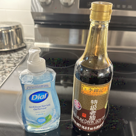
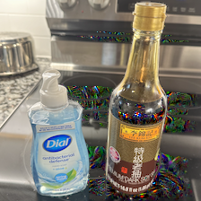
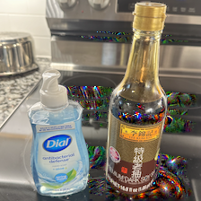
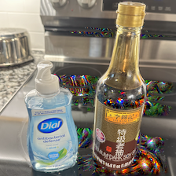
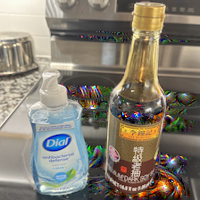

# Write-up

This challenge requires the players to create an image that will be classified as "espresso" by a SqueezeNet model pretrained on the IMAGENET1K_V1 dataset. Instead of creating the image from scratch, players must modify a specific image and are only allowed to change certain pixels in that image.

There are multiple ways to achieve this task. For readers unfamiliar with this topic, [Network Visualization (PyTorch)](https://github.com/chriskhanhtran/CS231n-CV/blob/master/assignment3/NetworkVisualization-PyTorch.ipynb) is a great place to get started.

Here, we provide a solution based on "Class Visualization," which synthesizes an image to maximize the classification score of a particular class. To account for the pixel constraints, we can set the gradients to zero for the non-changeable pixels and reset their values after each iteration.

We have provided a [solution script](../src/src/solution.py):

```bash
> mkdir /tmp/images
> (cd src && rye run python src/solution.py --output-dir /tmp/images)

Number of dark pixels: 21102.0
Saved intermediate image at /tmp/images/generated_image_iter0.png. Current prediction: 438 (beaker)
Saved intermediate image at /tmp/images/generated_image_iter99.png. Current prediction: 440 (beer bottle)
Saved intermediate image at /tmp/images/generated_image_iter199.png. Current prediction: 441 (beer glass)
Saved intermediate image at /tmp/images/generated_image_iter299.png. Current prediction: 441 (beer glass)
Saved intermediate image at /tmp/images/generated_image_iter399.png. Current prediction: 967 (espresso)
Saved the final output at /tmp/images/generated_image.png.
```

This has created the following images:

iter=0             |  iter=99
:-------------------------:|:-------------------------:
  |  

iter=199             |  iter=299
:-------------------------:|:-------------------------:
  |  

iter=399 (I'm espresso now)             |
:-------------------------:
  | 

Afterward, we can send the image to retrieve the flag:

```
cd src && python src/submit_solution.py --ip <IP> --port <IP> --image /tmp/test/generated_image.png
[+] Opening connection to <IP> on port <IP>: Done
[+] Receiving all data: Done (86B)
[*] Closed connection to <IP> port <IP>
Congrats! Your flag is on the way!
ictf{fur7her_ste@m_7he_h@nds0ap_and_u_g3t_a_l@tte}
```

Note that I haven't taken the time to make the model behave deterministically. Therefore, the model's classification result could be a bit random. If you generate an image that passes the check locally but still fails to pass the check remotely, try submitting more times and you will likely get a green signal.